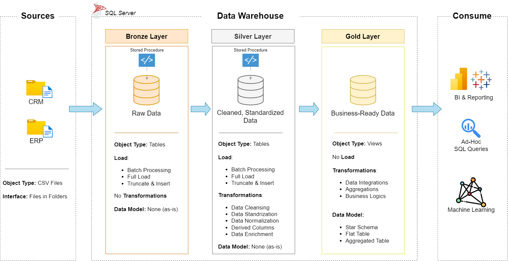

# SQL Data Warehouse and Analytics Project

Welcome to my **SQL Data Warehouse and Analytics Project!** 🚀

This repository showcases my learning and practical implementation of building a modern SQL Data Warehouse using Microsoft SQL Server. The project focuses on integrating data from multiple source systems, performing ETL (Extract, Transform, Load) operations, implementing data cleaning techniques, and developing analytical data models to generate meaningful business insights.

Through this project, I aim to strengthen my understanding of SQL development, Data Warehousing, ETL pipelines, and Data Analytics while following industry-standard practices.

---

## 🏗️ Data Architecture

The project follows the **Medallion Architecture**, consisting of three layers: Bronze, Silver, and Gold.



### 1. Bronze Layer – Raw Data
- Stores raw data directly from the source systems.
- Imports data from CRM and ERP CSV files into SQL Server.
- Maintains the original structure of the source data.
- Acts as the initial staging layer for data processing.

### 2. Silver Layer – Cleansed Data
- Performs data cleaning and transformation.
- Handles missing values and duplicate records.
- Standardizes data formats and resolves inconsistencies.
- Integrates data from multiple source systems.

### 3. Gold Layer – Business-Ready Data
- Stores transformed and analytical data.
- Implements business rules and data modeling.
- Organizes data into Fact and Dimension tables.
- Uses Star Schema for efficient analytical reporting.

---

## 📖 Project Overview

This project focuses on developing a modern SQL Data Warehouse and performing data analytics using SQL Server.

The major components include:

1. **Data Architecture:** Designing a structured Data Warehouse using the Medallion Architecture (Bronze, Silver, and Gold layers).

2. **Database Initialization:** Creating the Data Warehouse database and organizing schemas for different processing layers.

3. **ETL Pipelines:** Extracting, transforming, and loading data from CRM and ERP source systems.

4. **Data Cleaning:** Identifying and resolving data quality issues to ensure reliable and consistent datasets.

5. **Data Integration:** Combining data from multiple source systems into a unified data model.

6. **Data Modeling:** Developing Fact and Dimension tables using Star Schema principles.

7. **Data Analytics:** Writing SQL queries to analyze customer behavior, product performance, and sales trends.

---

## 🎯 Project Objectives

- Build a modern SQL Data Warehouse using Microsoft SQL Server.
- Integrate data from multiple source systems.
- Develop structured ETL workflows.
- Perform data cleansing and standardization.
- Implement dimensional data modeling.
- Generate meaningful business insights through SQL analytics.
- Maintain clear and organized project documentation.

---

## 🛠️ Technologies & Tools Used

| Technology | Purpose |
|---|---|
| Microsoft SQL Server | Database management |
| SQL | Data extraction, transformation, and analysis |
| SQL Server Management Studio (SSMS) | SQL development environment |
| Git | Version control |
| GitHub | Project hosting and documentation |
| Draw.io | Data architecture and modeling diagrams |

---

## 📊 Key Features

- **Medallion Architecture:** Structured data processing using Bronze, Silver, and Gold layers.
- **Database Management:** Organized database and schema creation.
- **ETL Development:** Data extraction, transformation, and loading.
- **Data Quality:** Cleaning, validation, and standardization.
- **Data Integration:** Combining CRM and ERP datasets.
- **Dimensional Modeling:** Fact and Dimension table implementation.
- **SQL Analytics:** Business-focused analytical queries.

---

## 📂 Repository Structure

```text
sql_datawarehouse_project/
│
├── datasets/
│   ├── source_crm/
│   └── source_erp/
│
├── docs/
│   ├── data_architecture.png
│   ├── data_architecture.drawio
│   ├── data_catalog.md
│   ├── data_flow.drawio
│   ├── data_models.drawio
│   └── requirements.md
│
├── scripts/
│   ├── init_database.sql
│   │
│   ├── bronze/
│   │   ├── ddl_bronze.sql
│   │   └── proc_load_bronze.sql
│   │
│   ├── silver/
│   │   ├── ddl_silver.sql
│   │   └── proc_load_silver.sql
│   │
│   └── gold/
│       └── ddl_gold.sql
│
├── tests/
│
├── README.md
├── LICENSE
└── .gitignore
```

---

## 🚀 Project Requirements

### 1. Building the Data Warehouse – Data Engineering

**Objective:**

Develop a modern SQL Data Warehouse using Microsoft SQL Server to consolidate sales data from multiple source systems and prepare it for analytical reporting.

**Specifications:**

- **Data Sources:** Import data from CRM and ERP systems provided in CSV format.
- **Data Quality:** Clean and resolve data inconsistencies before analysis.
- **Data Integration:** Combine multiple source systems into a unified data model.
- **Data Architecture:** Implement Bronze, Silver, and Gold processing layers.
- **Data Modeling:** Develop Fact and Dimension tables using Star Schema.
- **Scope:** Focus on the latest available dataset without requiring historical data tracking.
- **Documentation:** Maintain clear documentation of database structures, data models, and processing workflows.

### 2. Business Intelligence – Data Analytics

**Objective:**

Develop SQL-based analytical queries to generate meaningful business insights and support data-driven decision-making.

**Analysis Areas:**

- **Customer Behavior:** Understand customer purchasing patterns and preferences.
- **Product Performance:** Analyze product sales and performance.
- **Sales Trends:** Identify sales patterns and business growth opportunities.

---

## ⚙️ How to Run the Project

Follow these steps to set up and execute the project:

**Step 1: Clone the Repository**

```bash
git clone https://github.com/your-username/sql_datawarehouse_project.git
```

**Step 2: Open SQL Server Management Studio (SSMS)**

Connect to your SQL Server instance.

**Step 3: Initialize the Database**

Navigate to:

```text
scripts/init_database.sql
```

Execute the script to create the DataWarehouse database and the Bronze, Silver, and Gold schemas.

**Step 4: Execute the SQL Scripts**

Run the scripts in the following sequence:

1. Database Initialization
2. Bronze Layer
3. Silver Layer
4. Gold Layer

**Step 5: Verify the Results**

Check the database, schemas, tables, and transformed datasets in SQL Server Management Studio.

---

## 📚 Key Learning Outcomes

Through this project, I am developing practical knowledge and hands-on experience in:

- SQL Server and Database Management.
- Data Warehouse Architecture.
- Medallion Architecture.
- ETL Pipeline Development.
- Data Cleaning and Transformation.
- Data Integration.
- Star Schema and Dimensional Modeling.
- Fact and Dimension Tables.
- SQL Query Development and Data Analytics.
- Git and GitHub Version Control.

---

## 🔗 Important Resources & Tools

- [Microsoft SQL Server](https://www.microsoft.com/en-us/sql-server/sql-server-downloads)
- [SQL Server Management Studio](https://learn.microsoft.com/en-us/ssms/install/install)
- [GitHub](https://github.com/)
- [Draw.io](https://www.drawio.com/)
- [SQL Documentation](https://learn.microsoft.com/en-us/sql/)

---

## 🌟 About Me

Hi! I'm Harrsita S an Information Technology graduate with an interest in SQL Development, Data Analytics, and Data Engineering.

I enjoy exploring new technologies, solving technical problems, and building practical projects that help me improve my technical and analytical skills.

This project is part of my continuous learning journey in the field of Data Engineering and Analytics.

**Let's Connect!**

- **GitHub:** https://github.com/harrsita
- **LinkedIn:** www.linkedin.com/in/harrsita

---

⭐ If you find this project interesting, feel free to explore the repository and share your feedback!

Thank you for visiting my SQL Data Warehouse and Analytics Project! 🚀
